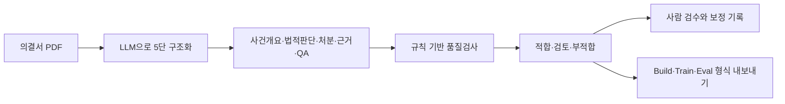

# DecisionMiner

공정거래위원회 공개 의결서를 구조화된 QA·메타데이터로 변환하고, 규칙 기반 품질검사와 사람 검수 기록을 함께 제공하는 데이터 구축 프로젝트입니다. 팀 세종대왕의 공모전 제출 결과와 실행 코드를 기준 버전으로 보존합니다.

## 현재 구현



분해와 QA 생성에는 LLM을 사용합니다. 현재 자동 검수기는 정규식, 필드·분류 정합, 단어 겹침 등의 규칙을 사용하며 LLM Judge를 호출하지 않습니다. `Eval`이라는 파일명은 내보내기 용도이며 독립 평가셋임을 뜻하지 않습니다.

## 확인된 산출물

| 항목 | 규모 | 근거 |
| --- | ---: | --- |
| 의결서 인벤토리 | 500건 | `01_data_inventory/inventory_full.csv` |
| 선정·처리 사건 | 22건 | 선정 목록 및 사건별 JSON |
| 합성 QA | 990건 | 사건당 45건 |
| 요약·사실관계·분류·추론 메타데이터 | 각 22건, 합계 88건 | `11_data_quality/dataset_*_22.csv` |
| 최종 정적 라벨 | 적합 195 / 검토 768 / 부적합 27 | 최종 설계서와 라벨맵 일치 |
| 기존 사람 검수 | QA 990건 중 100건 | 검수 원본과 설계서의 ID·판정 대조 |

적합+검토 963/990(97.3%)는 **선별 규칙에 따른 분류 비율**입니다. 법률 정답률이나 학습 성능을 나타내지 않습니다. 검토 등급에는 보정·확인이 필요한 사례가 포함됩니다.

100건 검수는 기존 기준 정밀화에 사용된 교정 표본입니다. 최종 라벨과 과거 검수 판정을 다시 연결하면 세 범주 일치 55/100, 사용가능/부적합 이진 일치 98/100입니다. 제출 문서의 99%는 구 CSV 라벨로 재현되며, 역사적 88%와도 계산 정의가 다릅니다. **[수치·계산 정의](docs/BASELINE.md)**를 함께 읽어 주세요.

## 실행

Python 3.11 이상을 권장합니다. 저장된 자료를 읽는 감사 명령은 모델 API를 호출하지 않습니다.

```bash
python -m venv .venv
source .venv/bin/activate
python -m pip install -r requirements-audit.txt
python scripts/audit_baseline.py
```

### 2차 웹 데모

공모전 시연에 사용된 웹·서버를 `web_demo/`에 보존했습니다. 브라우저의 기존 샘플·규칙 검사·다운로드와 신규 PDF의 API 분해를 구분합니다.

키 없이 기존 샘플을 살펴보기:

```bash
python -m http.server 8000 --directory web_demo
```

브라우저에서 `http://localhost:8000`을 엽니다. 이 방식에서는 신규 PDF의 LLM 분해 API를 사용할 수 없습니다.

서버와 신규 PDF 분해:

```bash
python -m pip install -r web_demo/requirements.txt
# ANTHROPIC_API_KEY를 환경변수로 설정한 후 실행
cd web_demo
python server.py
```

기본 포트는 7860입니다. 실제 PDF 분해는 Anthropic API 호출 비용이 발생합니다. 자세한 환경변수와 원본 배포 설정은 [데모 안내](web_demo/README.md)를 참고하세요.

### 기존 배치·Streamlit

`09_code/`는 데이터 생산 파이프라인과 1차 Streamlit 데모입니다. `streamlit_demo/`는 별도의 페이지 1 시연입니다. 과거 배치 재생성에는 저장소 밖의 원문 PDF·메타데이터와 인벤토리 경로 설정이 필요합니다. 코드 안의 모델 식별자와 일부 절대경로는 당시 설정이므로 실행 환경에 맞춰 확인해야 합니다. 현재 기준 버전에서 새 데이터 생성이나 모델 재학습은 수행하지 않았습니다.

## 저장소 안내

| 위치 | 내용 |
| --- | --- |
| `releases/competition_final.xlsx` | 최종 제출 설계서, 원본 바이트 보존 |
| `releases/reviewer_100.xlsx` | 기존 사람 검수 100건 원본 |
| `web_demo/` | 2차 웹 시연 서버·HTML·React 소스 |
| `03_prompts/v2/`, `09_code/` | 배치 생성 프롬프트·생산·검수·내보내기 코드 |
| `04_raw_outputs/` | 사건별 5단 JSON과 기존 내보내기 결과 |
| `11_data_quality/` | QA·메타 CSV·과거 검수 결과·최종 정적 라벨 |
| `scripts/audit_baseline.py` | 저장된 원자료를 읽어 수치를 대조하는 명령 |
| `docs/baseline_metrics.json` | 기준 버전의 계산 결과·입력 파일 해시 |

이전 설계서·초안·클라우드 복사본은 계보 확인을 위해 남겼습니다. 최신 제출 결과는 `releases/`를 기준으로 확인하세요.

## 선행연구와 후속 작업

[LBOX OPEN](https://arxiv.org/abs/2206.05224), [KBL](https://aclanthology.org/2024.findings-emnlp.319/), [LegalBench](https://arxiv.org/abs/2308.11462)를 법률 데이터셋·과제 설계의 비교 대상으로 검토했습니다. 이들과 동일 조건으로 모델 성능을 비교한 실험은 없습니다. [논문별 연결점](docs/RELATED_WORK.md)과 [후속 연구 계획](docs/RESEARCH_PLAN.md)을 구분해 기록했습니다.

현재 한계는 작은 사건 범위, 합성 답변의 법리 오류 가능성, 교정 표본과 최종 평가 표본의 미분리, 정적 라벨과 경량 라이브 검수기의 차이입니다. 기존 `eval_gold.json`은 동일 QA 풀에서 나온 참조 데이터이며, 990건 모두가 전문가 확정 정답이라는 뜻은 아닙니다.

## 기여와 출처

공모전 신청서상 팀은 **세종대왕**, 팀 대표는 **손종명**, 팀원은 **박세하**입니다. 계획서에는 프로젝트 Owner와 법학 전공 검수 담당 B가 구분되어 있습니다. 구현에는 Claude Code 등 AI 코딩 도구가 활용되었습니다. 문서로 확인되는 역할과 확인 범위는 [기여 기록](docs/CONTRIBUTIONS.md)에 정리했습니다.

공개 의결서와 생성·검수 산출물의 출처·가공 계보는 [데이터 설명](docs/DATA_CARD.md)과 [파일 출처 해시](docs/source_manifest.json)를 참고하세요. 본 저장소는 공정거래위원회의 공식 서비스나 법률 자문 서비스가 아닙니다.
